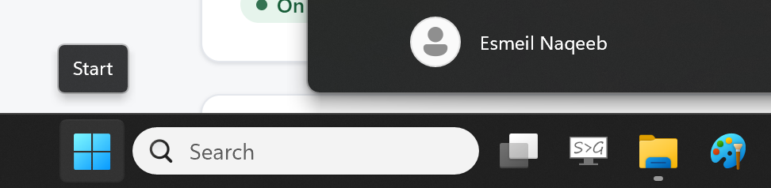
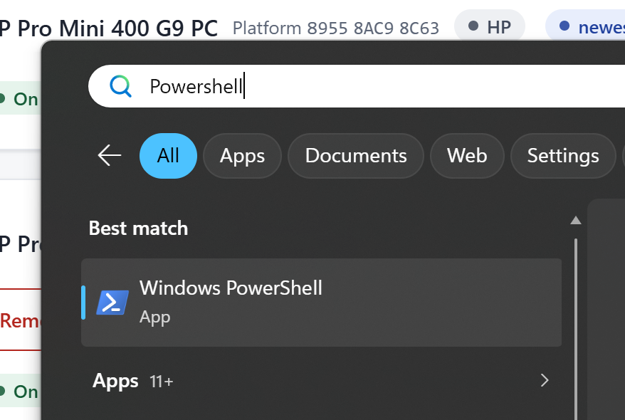
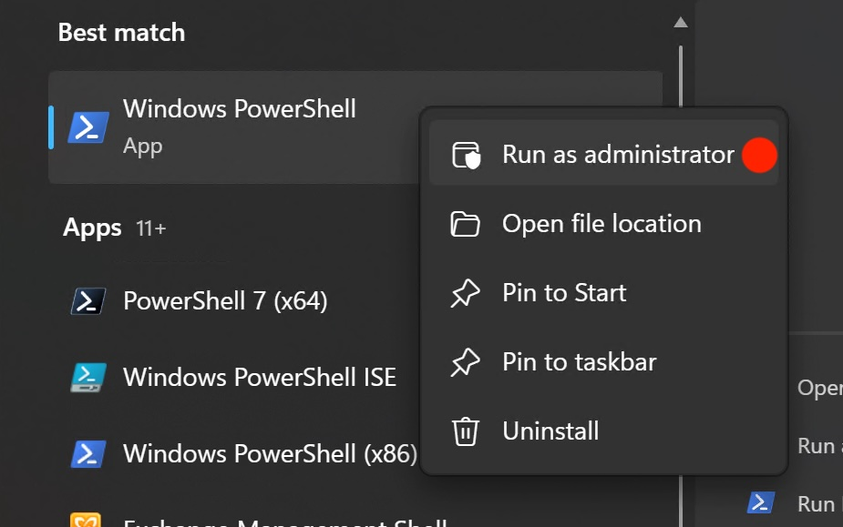
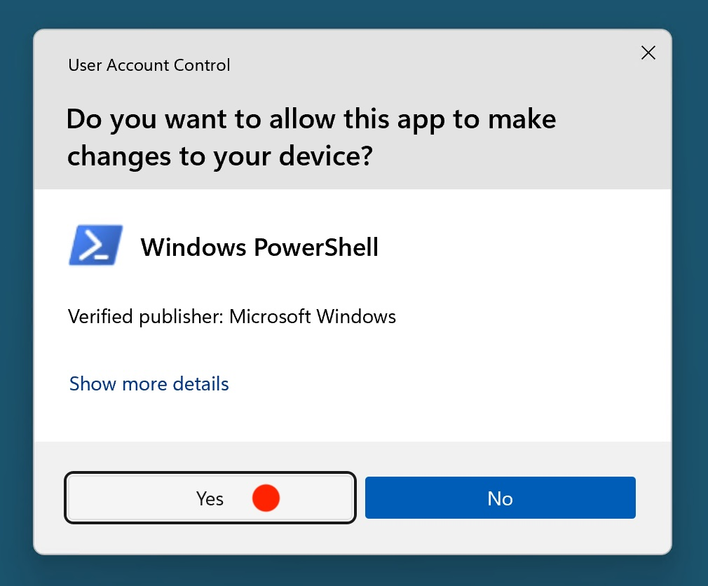
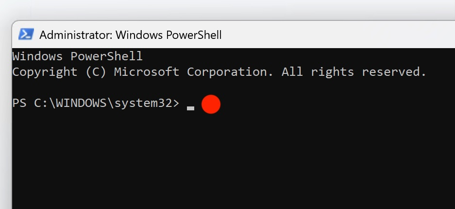

# Tollway Citrix Install

Sets up a remote Tollway employee's Windows laptop or desktop for Citrix access. One PowerShell command block does all of the following:

1. Removes any existing Citrix software.
2. Installs **Citrix Workspace App LTSR 2507.1 CU3 Hotfix 1** silently, with auto-update and telemetry turned off.
3. Adds two shortcuts to every user's desktop:
   - **Tollway Citrix**: opens https://ra.ccsc.tollway.state.il.us/
   - **Tollway Assistance**: opens the Tollway help desk remote-support page (https://tollwayhelpdesk.screenconnect.com/)

**Time needed:** about 5–10 minutes.

---

## Before you start

- **Windows 10 or 11**, with an account that has **administrator rights**.
- **Internet connection.** The installer is downloaded from GitHub during setup.
- **Save your work and close Citrix.** Any program with "Citrix" in its name will be **uninstalled**, including older Workspace or Receiver versions.

---

## Steps

### 1. Open the Start menu

Click the **Start** button (Windows logo) on the taskbar.



### 2. Search for PowerShell

Type **PowerShell**. **Windows PowerShell** appears under *Best match*.



### 3. Run PowerShell as administrator

**Right-click** **Windows PowerShell** and choose **Run as administrator**.



### 4. Allow the change

When the **User Account Control** window asks *"Do you want to allow this app to make changes to your device?"*, click **Yes**.



### 5. Paste and run the commands

A blue or black window titled **Administrator: Windows PowerShell** opens. The title **must** begin with *Administrator*. If it doesn't, close the window and repeat step 3.



Copy the whole block below. On GitHub, you can use the copy button in its top-right corner. Then **right-click inside the PowerShell window** to paste it, and press **Enter**.

```powershell
Set-ExecutionPolicy -Scope Process -ExecutionPolicy Bypass -Force
$ProgressPreference = 'SilentlyContinue'
Set-Location C:\
New-Item -ItemType Directory -Force -Path tolltemp | Out-Null
Set-Location tolltemp
Invoke-WebRequest -Uri "https://github.com/The-Chicago-Lighthouse/toll-citrix-install/archive/refs/heads/main.zip" -OutFile "main.zip"
Expand-Archive -Path "main.zip" -DestinationPath . -Force
Set-Location "toll-citrix-install-main"
Start-BitsTransfer -Source "https://github.com/The-Chicago-Lighthouse/toll-citrix-install/raw/refs/heads/main/CitrixWorkspaceApp.exe?download=CitrixWorkspaceApp.exe" -Destination "CitrixWorkspaceAppCLH.exe"
.\Citrix_Uninstaller.ps1
Start-Process ".\main.bat"

```

### 6. Wait for it to finish

- PowerShell lists any old Citrix programs as it removes them, then shows **Uninstallation loop complete.**
- A second black window opens. It tests the internet connection, installs Citrix, and copies the desktop shortcuts. The install step can take a few minutes with no visible progress. **Don't close the window.**
- When you see **Placing Shortcuts on desktop...[COMPLETED]**, the window closes itself after 10 seconds.

### 7. Check the result

1. Look for **Tollway Citrix** and **Tollway Assistance** on the desktop.
2. Double-click **Tollway Citrix** and sign in with your Tollway credentials.
3. Restart the computer if Citrix asks you to.

You can now close PowerShell.

---

## Troubleshooting

| Problem | What to do |
|---|---|
| `Access is denied` or `Requires elevation` | PowerShell isn't running as administrator. Close it and repeat steps 3–5. |
| `running scripts is disabled on this system` | The first line of the command block was left out. Paste the **whole** block again. |
| Download errors (`Invoke-WebRequest` or `Start-BitsTransfer` fails) | Check the internet connection, disconnect from any VPN, and run the block again. Re-running it is safe. |
| `Request timed out` while pinging `ra.ccsc.tollway.state.il.us` | This is a connection test only, and the install continues anyway. If the **Tollway Citrix** shortcut won't load afterwards, contact the Tollway help desk. |
| Shortcuts didn't appear on the desktop | Press **F5** on the desktop to refresh it, or sign out and back in. |
| Anything else | Contact Chicago Lighthouse IT (details below) and send a photo of the error. |

### Optional: clean up

After everything works, you can delete the temporary files. In an administrator PowerShell window, run:

```powershell
Remove-Item -Recurse -Force C:\tolltemp
```

---

## What's in this repository

| File | Purpose |
|---|---|
| `Citrix_Uninstaller.ps1` | Silently uninstalls every installed program whose name contains "Citrix". |
| `main.bat` | Tests connectivity, installs Citrix Workspace silently, and copies the shortcuts to `C:\Users\Public\Desktop`. |
| `CitrixWorkspaceApp.exe` | Citrix Workspace App installer, stored with Git LFS. |
| `Tollway Citrix.url` | Desktop shortcut to the Tollway Citrix portal. |
| `Tollway Assistance.url` | Desktop shortcut to Tollway help desk remote support. |
| `screenshots/` | Images used in this guide. |

---

## Contact

Esmeil Naqeeb  
Network Security Engineer, The Chicago Lighthouse  
Email: [Esmeil.Naqeeb@chicagolighthouse.org](mailto:Esmeil.Naqeeb@chicagolighthouse.org)
